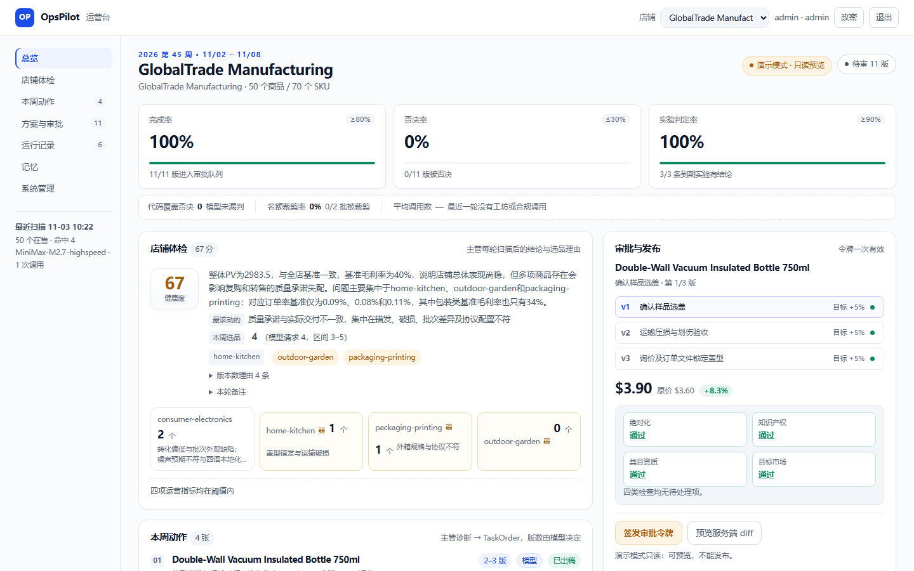
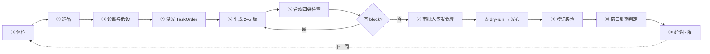
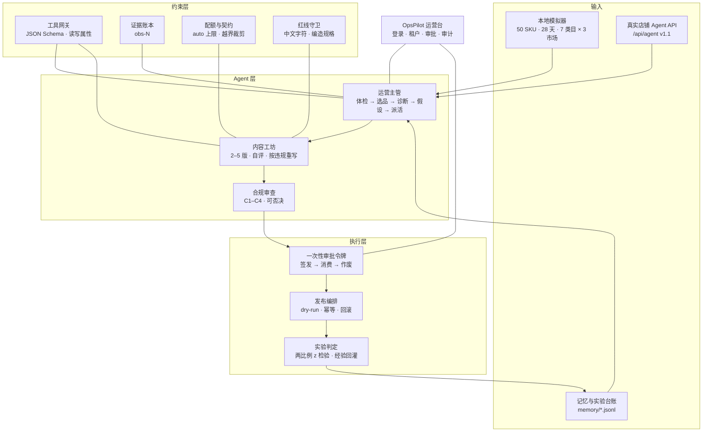

# OpsPilot · 跨境商品运营 Agent

> 一个会自己干活的跨境商品运营 Agent：每周自己体检、自己选品、自己写文案、自己过合规，等人点头后发布，再判实验、把结论记进下一周。
>
> **核心主张：模型负责判断，代码负责边界。**

[](https://www.python.org/)
[](tests)
[](https://github.com/cicisay/OpsPilot/actions/workflows/tests.yml)
[](pyproject.toml)
[](LICENSE)
[](https://github.com/cicisay)



---

## 目录

- [它解决什么问题](#它解决什么问题)
- [核心能力](#核心能力)
- [一周的闭环](#一周的闭环)
- [架构](#架构)
- [快速开始](#快速开始)
- [跑完一周](#跑完一周)
- [命令行](#命令行)
- [配置](#配置)
- [测试](#测试)
- [目录结构](#目录结构)
- [设计取舍](#设计取舍)
- [安全与数据声明](#安全与数据声明)
- [文档](#文档)
- [已知限制](#已知限制)
- [License](#license)

## 它解决什么问题

跨境 B2B 店铺的运营循环并不复杂：看数据、挑商品、改文案、调价格、上线、看结果。难的是**让模型参与决策却不失控**。多数 Agent Demo 停在"模型能写出像样的方案"，这个项目往前多走了一步：把模型关进四道闸门里，让它真的能跑完一周，而且每一步都能被追问。

| 常见翻车点 | 本项目的做法 |
| --- | --- |
| 模型自己编 SKU、指标和证据 | 数据只来自模拟器或站点 API；agent 模式下每次工具调用编号 `obs-N`，选品必须引用 ≥2 条本次真实观察，否则重来 |
| 文案里混进中文、编造重量/尺寸/材料 | `*En` 字段出现中文字符直接丢弃；规格数字必须能在现有标题、卖点、描述、MOQ、交期里找到 |
| 合规靠模型自觉 | 规则层先查绝对化用语、品牌词、版权、禁售类目；出现 `block` 的版本不能进审批队列，审批令牌也不能覆盖 |
| 模型直接改价、直接上线 | 写入类工具永远不给模型；价格只能从代码算出的价位点里选；真实写入需要"合规通过 + 有效令牌 + 商品锁"三件齐备 |
| 审批走过场 | 一次性令牌绑定 SKU 与动作，签发后消费即废，跨会话持久化 |
| 只说"优化了"，不证明有效 | 发布成功即登记实验，窗口到期用两比例 z 检验判定；样本不足不给"成立"，并给出"还差多少曝光" |
| 经验越攒越假 | 经验归纳要求数字可溯源、单条证据置信 ≤ 0.4；模型不可用时不写假经验 |

## 核心能力

### 决策：先体检，再动手

- 确定性生成 **50 个 SKU**（7 个类目 × 3 个市场）与 **28 天**曝光 / 点击 / 转化 / 退货模拟数据，固定随机种子，结果可复现。
- 运营主管按类目中位数体检，输出健康度、异常类目、诊断、假设、成功判据、价格带，并自主决定改 **3–5 个 SKU**、每个出几版；代码只在越界时裁剪并记录 `guarded=true`。
- `--limit auto` 是默认值：模型看到 50 件在售、8 件异常、人工上限 24 版后自己决定改 4 个还是 6 个。

### 生产：模型写文案，代码管事实

- 内容工坊按任务单生成 **2–5 版**标题 / 卖点 / 描述 / 素材 brief，逐版过合规，带 before/after 预览。
- 三道代码闸门：中文字符检测、规格数字溯源、价格价位点约束。
- 工坊失败不回落规则模板：按红线与契约错误定向重写最多 2 轮，仍失败就记录失败原因，避免"看起来成功了，其实是模板"。

### 合规：不是一个提示词

- 规则化词库覆盖绝对化用语、品牌词、版权、禁售类目，支持 US / DE / UK 市场词库。
- 合规审查 Agent 独立成角色，只拿成品和规则，做 **C1–C4 四类检查**，可否决。
- 运营台用四类矩阵展示，不再用一个绿标盖住某个 `warn`；`block` 版本整颗按钮转浅红，签发与发布同时禁用。

### 发布：默认只预演

- 发布编排默认 dry-run；真实发布要求合规通过、有效令牌、商品锁同时满足。
- 幂等键按店铺隔离，失败按"商品内容先写、价格后写"的顺序补偿回滚。
- 适配器只走 HTTP（`SitePlatform`），不 import 站点代码；测试注入假传输层。

### 实验：结论必须有统计

- 发布成功即登记实验，基线冻结为发布前 28 天，窗口取任务单。
- 四态判定：成立 / 不成立 / 不确定 / 样本不足；两比例 z 检验，样本不够不给"成立"。
- 已判定实验由模型归纳进经验库，下一轮主管决策自动带上实验与经验；每周开头零成本判定所有到期实验。

### 运营台：能看、能审、能查

- OpsPilot 单页控制台：登录、租户切换、店铺体检、本周动作、方案与审批、运行记录、记忆回放、系统管理。
- PBKDF2 密码、HttpOnly 会话、CSRF、登录限流；`admin` / `approver` / `operator` 三角色。
- 多租户独立数据目录与站点配置；SQLite 审计记录登录、审批、预览、发布、用户变更，可按租户查询与 CSV 导出（UTF-8 BOM、防公式注入）。
- 支持 `--tls-cert/--tls-key`（TLS 1.2+，HTTPS 下自动 HSTS）。

### 工程：零运行时依赖

- 纯 Python 标准库，`pyproject.toml` 的 `dependencies = []`；`run.py` 免安装启动。
- 前端无构建步骤，CSP 下不使用内联样式。
- **972 个单元测试、47 个测试文件**，覆盖适配器、三个 Agent、工具循环与证据校验、配额与契约、记忆、红线、发布闸门、实验统计、运营台视图层、认证与多租户。

## 一周的闭环



## 架构



| 层 | 位置 | 职责 |
| --- | --- | --- |
| 入口 | `run.py`、`src/ops_agent/cli.py` | 免安装启动器与 15 组子命令 |
| 领域 | `models.py`、`catalog.py`、`simulator.py`、`platform.py` | SKU、模拟店铺、版本与回滚 |
| Agent | `agents/` | 主管（oneshot / 研究循环）、工坊、合规、红线守卫 |
| 约束 | `runtime/`、`tools.py`、`contracts.py`、`quota.py` | 工具网关、证据账本、预算循环、契约与配额 |
| 执行 | `publish.py`、`approvals.py`、`experiment.py`、`lessons.py` | 发布闸门、令牌、实验统计、经验归纳 |
| 界面 | `console/` | 认证、租户、SQLite、审计、只读视图层、单页前端 |

## 快速开始

### 环境要求

- Python **3.11+**（Windows / macOS / Linux 均可）
- **无需 `pip install`**，运行时只用标准库
- 可选：任意 OpenAI 兼容大模型 Key（DeepSeek / Qwen / GLM / Moonshot / MiniMax / OpenAI / Ollama）

### 运行

```bash
git clone https://github.com/cicisay/OpsPilot.git
cd crossborder-ops-agent

# 1) 生成模拟店铺（50 个 SKU + 28 天表现）
python run.py seed

# 2) 首次初始化运营台账号
python run.py console init \
  --admin-password "Demo12345" \
  --approver-password "Approve12345" \
  --operator-password "Operate12345"

# 3) 演示模式启动：只读预览，不能发布
python run.py console serve --demo --port 8788
```

打开 **<http://127.0.0.1:8788>**。

Windows 也可以直接双击 `START-WINDOWS.bat`（默认演示模式；加 `full` 参数进入可审批、可发布的普通模式）。macOS / Linux 用 `./start.sh`。

### 演示账号

| 账号 | 角色 | 权限 |
| --- | --- | --- |
| `admin` | 管理员 | 全部功能 + 用户管理 + 审计 |
| `approver` | 审批人 | 查看方案、签发一次性审批令牌 |
| `operator` | 运营 | 查看方案、预览、凭令牌发布 |

> 密码由初始化命令指定，只初始化时创建；**首次登录后请立即修改**。忘记密码可删除 `data/console/` 后重新初始化。

### 接入大模型（可选）

```bash
copy .env.example .env          # macOS / Linux: cp .env.example .env
# 编辑 .env：LLM_PROVIDER=deepseek，LLM_API_KEY=sk-...

python run.py director run      # 主管决策：改几个、改哪个、为什么
python run.py agent run         # 主管 + 工坊 + 合规，一条命令
```

不填 Key 也能跑：系统停留在确定性的规则基线（`--planner rule`）。填了 Key，模型才开始做诊断、选角度、定版数、写文案。Key 只放 `.env`，已被 `.gitignore` 排除。

## 跑完一周

```bash
# 1) 体检 / 选品 / 诊断 / 假设 / 派活（模型决策）
python run.py director run

# 2) 生成方案包（离线或实时）
python run.py workshop run --offline
python run.py workshop run

# 3) 合规审查
python run.py review run --offline --limit 3

# 4) 发布预演（默认不写入）
python run.py publish run --limit 1

# 5) 审批人签发一次性令牌（需要审批人密钥）
export OPS_APPROVER_TOKEN="..."
python run.py approve issue --product-id SKU-1001 --variant-key SKU-1001-v1 --operator alice

# 6) 执行发布（令牌一次有效，成功后自动登记实验）
python run.py publish run --limit 1 --approval-token APR-...

# 7) 窗口到期后判定，并归纳进经验库
python run.py experiment list
python run.py experiment judge --as-of 2026-11-03
python run.py experiment judge --no-lessons     # 只判定，不调用模型
```

> Windows PowerShell 请用 `$env:OPS_APPROVER_TOKEN = "..."`。

产物落在：`data/task_orders.json`、`data/workshop_proposals.json`、`data/review_results.json`、`data/publish_results.json`。

### 连接真实店铺

```bash
export SITE_AGENT_TOKEN="<站点 .env 里的 AGENT_API_TOKEN>"
export SITE_AGENT_BASE_URL="http://localhost:3000/api/agent"

python run.py site check
python run.py site products --limit 10
python run.py site sync
python run.py site dry-run --variant-id <variantId> --price-cents 1180
```

站点侧接口约定见 [`docs/step-03-site-adapter.md`](docs/step-03-site-adapter.md)。目前只实现 `selfhosted` 连接器；Shopify / WooCommerce 会明确报错，不伪造成功。

## 命令行

| 命令 | 作用 |
| --- | --- |
| `run.py seed` / `summary` / `simulate` | 生成模拟店铺、看机会分、单 SKU 改动模拟 |
| `run.py tools list` / `demo` | 9 个工具及其读写/审批属性；跑完整链路演示 |
| `run.py site check` / `products` / `sync` / `dry-run` | 真实店铺连接、读取、同步、预演 |
| `run.py director run` | 运营主管：体检、选品、诊断、假设、派活（`--runtime agent` 走工具循环） |
| `run.py workshop run` | 内容工坊：TaskOrder → 2–5 版方案（`--offline` 不调模型） |
| `run.py review run` | 合规审查：逐版检查，可否决 |
| `run.py publish run` | 发布编排：默认 dry-run，`--approval-token` 才写入 |
| `run.py approve issue` / `list` | 签发 / 查看一次性审批令牌（脱敏） |
| `run.py experiment list` / `register` / `judge` | 实验台账、手工补登记、到期判定与经验回灌 |
| `run.py console init` / `migrate` / `serve` | 初始化账号、JSON → SQLite 迁移、启动运营台 |
| `run.py agent run` | 主管 → 工坊 → 合规，一条命令 |
| `run.py intake run` | 一句话委托的意图识别与草案预览（后端保留，UI 已下线） |

## 配置

复制 `.env.example` 为 `.env` 后按需修改。完整注释在文件里，常用项：

| 变量 | 默认 | 说明 |
| --- | --- | --- |
| `LLM_PROVIDER` | `deepseek` | `deepseek` / `qwen` / `glm` / `moonshot` / `minimax` / `openai` / `ollama` |
| `LLM_API_KEY` | 空 | 留空则停留在规则基线；Ollama 可留空 |
| `LLM_MODEL` / `LLM_BASE_URL` | 空 | 留空使用 Provider 预设 |
| `LLM_MAX_TOKENS` | `4096` | 推理模型的思考 token 也计入；耗尽时客户端自动扩容重试一次 |
| `LLM_TIMEOUT` | `120` | 单次调用超时（秒） |
| `OPS_RUNTIME` | `oneshot` | `agent` 时主管带只读工具自己查证据 |
| `SITE_AGENT_TOKEN` / `SITE_AGENT_BASE_URL` | 空 | 真实店铺凭据与地址；`SITE_AGENT_TOKEN_FILE` 支持每次请求重读（轮换） |
| `OPS_APPROVER_TOKEN` | 空 | 签发审批令牌时校验的审批人密钥 |
| `OPS_LEXICON_PATH` | 空 | 覆盖合规词库路径（否则按租户目录 → `data/compliance/`） |

硬边界也写在 `.env`：`LLM_MAX_CALLS_PER_ITEM`、`LLM_MAX_REVISION_ROUNDS`、工具循环的总 token / 步数 / 调用次数 / 时长上限。

## 测试

```bash
python -m unittest discover -s tests -v
```

**972 个测试 / 47 个文件**（实测 29.7s，Python 3.14），不需要网络或大模型 Key。覆盖：

- 模拟器与确定性数据、站点适配器（假传输层）
- 主管 / 工坊 / 合规三个 Agent 的契约、配额、红线与失败路径
- 研究 Agent 的工具循环、证据校验、预算耗尽
- 审批令牌、发布幂等、补偿回滚、合规闸门
- 实验登记、两比例检验、四态判定、经验归纳
- 运营台认证、CSRF、租户隔离、SQLite、审计导出
- 意图层（12 意图 / 槽位 / 消毒与回退）与 204 条语料评测

## 目录结构

```
crossborder-ops-agent/
├─ run.py                     # 免安装启动器
├─ START-WINDOWS.bat          # Windows 一键启动（演示 / full）
├─ start.sh                   # macOS / Linux 一键启动
├─ pyproject.toml             # 包元数据（零运行时依赖）
├─ src/ops_agent/
│  ├─ models.py               # 领域对象
│  ├─ catalog.py              # 50 个 SKU 的确定性生成
│  ├─ simulator.py            # 店铺表现模拟与单变量改动
│  ├─ platform.py             # mock 平台：快照、发布、回滚、版本
│  ├─ site_platform.py        # 真实店铺 Agent API 适配器（HTTP）
│  ├─ supervisor.py           # 规则基线（对照用）
│  ├─ workshop.py             # 内容工坊：规则基线 + Agent 调度
│  ├─ agents/                 # 主管、研究 Agent、工坊、合规、红线守卫
│  ├─ runtime/                # 工具网关、证据账本、预算循环、运行状态
│  ├─ llm/                    # OpenAI 兼容客户端、JSON 解析、调用留痕
│  ├─ reviewer.py             # 词表合规基线（离线对照）
│  ├─ compliance.py           # 规则化合规检查 + 词库分层加载
│  ├─ publish.py              # 发布编排：dry-run、审批、幂等、补偿
│  ├─ approvals.py            # 一次性审批令牌（内存）
│  ├─ approval_store.py       # 审批令牌持久化（跨会话）
│  ├─ experiment.py           # 实验登记、两比例检验、四态判定
│  ├─ lessons.py              # 经验归纳：数字溯源、置信下限
│  ├─ tools.py                # 9 个执行工具 + 7 个只读研究工具
│  ├─ cli.py                  # 命令行入口
│  └─ console/                # OpsPilot：认证、审计、租户、SQLite、HTTP、前端
├─ tests/                     # 972 个单元测试
├─ docs/                      # PRD、流程记录、讲解手册、架构图
├─ data/                      # 运行产物（git-ignored）
└─ preview/                   # 排版评审快照（git-ignored）
```

## 设计取舍

- **不用 Agent 框架。** 工具循环、证据账本、预算和重试都是几十行显式代码，出问题能定位到行；也换来零依赖。
- **模型只能改文案，不能碰写入。** 发布、回滚等写操作不在模型工具表里，价格由 `_price_plan()` 计算，模型只能选价位点。
- **失败要显性。** 模型调用失败整批中止并记录原因，不静默回落到规则模板；证据不足重来，不补一条假观察。
- **规则基线保留作对照。** `--planner rule` 随时能跑，用来回答"模型到底比阈值规则强在哪"。
- **数据可复现。** 固定随机种子，测试与演示不依赖网络。

## 安全与数据声明

- **密钥不入库。** `LLM_API_KEY`、`SITE_AGENT_TOKEN`、`OPS_APPROVER_TOKEN` 只放环境变量或 `.env`；`.env` 已被 `.gitignore` 排除。若你曾把 Key 提交进过历史，请立刻轮换。
- **运行数据不入库。** `data/` 含账号哈希、审计库、租户快照、完整 prompt 留痕（可能含商家文案），默认全部忽略。
- **不抓页面、不直连站点数据库。** 只通过站点 `/api/agent/*` 读写。
- **验收对真实店铺只做 dry-run。** 真实写入路径由假站点单测覆盖。
- **不承诺 GMV。** 模拟数据用于验证决策与实验机制，真实效果需要客户店铺历史数据与 A/B 观察。
- 演示密码仅用于本地演示，上线前必须修改并加 TLS。

## 文档

| 文档 | 内容 |
| --- | --- |
| [`docs/跨境电商商品运营Agent PRD.md`](docs/%E8%B7%A8%E5%A2%83%E7%94%B5%E5%95%86%E5%95%86%E5%93%81%E8%BF%90%E8%90%A5Agent%20PRD.md) | 产品 PRD v1.1（主稿） |
| [`docs/testing-runbook.md`](docs/testing-runbook.md) | 在真实外贸站上的测试 Runbook |
| [`docs/step-16-agent-runtime.md`](docs/step-16-agent-runtime.md) | 工具循环与证据账本 |
| [`docs/step-12-p2-workshop-compliance.md`](docs/step-12-p2-workshop-compliance.md) | 多 Agent 协作与合规 |
| [`docs/step-13-p3-experiment-memory.md`](docs/step-13-p3-experiment-memory.md) | 实验台账与经验回灌 |
| [`使用说明.md`](使用说明.md) | 运营台一键启动与账号说明 |
| `docs/step-*.md` | 按里程碑记录的问题、方案与验收 |

## 已知限制

- 站点连接器只实现 `selfhosted`；Shopify / WooCommerce 明确报错，不伪造。
- 审批令牌与运行状态存本地文件 / SQLite，面向单机部署；多副本需要外置存储。
- 运营台没有独立前端构建链，复杂交互扩展性有限。
- CI 覆盖单元测试与文档守卫；真实站点联调仍需本地执行。

## License

[MIT](LICENSE) © 2026 [cicisay](https://github.com/cicisay)
