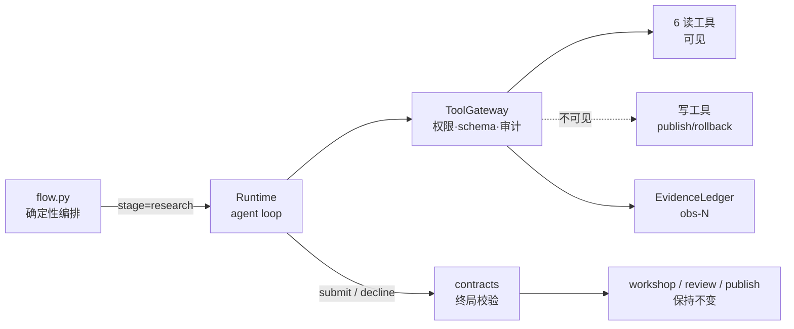

# L3 实施规格：把研究决策段做成真 Agent

> 目标：项目从 **L2（有环的 workflow）** 升到 **L3（模型掌握控制权的 agent）**。
> 范围：只改"研究—诊断—选品"这一段。发布、合规硬禁、实验判定、审批不动。
> 判据：① 控制权 ⑤ 工具 必须翻 ✓，②③ 已在 S1/S2 完成，④ 留给 S4。

---

## 0. 什么叫"成了"

不是"用了 ReAct"，是这四件事能当场演示：

| # | 证据 | 怎么演示 | 反例（说明没成） |
|---|---|---|---|
| 1 | 同一快照跑两次，**工具序列不同** | 两次 trace 并排 | 两次调用序列一模一样 = 还是固定路径 |
| 2 | 证据可溯源 | `evidence_refs` 全部指向本次 `obs-*` | 证据是中文散文，无法对应到任何观察 |
| 3 | 扰动自愈 | 类目只有 2 个样本 / 商品中途下架 → 换路径或 `decline` | 报错退出或整批中止 |
| 4 | 能说"不动" | `decline(reason, refs)` 进 decisions | 被迫凑够 N 个任务单 |

成本验收：每轮 token ≤ 8k（现在 18.7k）、500 个商品能跑通。

---

## 1. 架构：一个运行时，两种节点



**唯一的新抽象**：`Runtime` 跑 agent loop，`flow.py` 跑确定性阶段。research 阶段交给 Runtime，其余阶段仍是代码。这样下游产物不变，431 个测试不需要改。

---

## 2. 模块清单

| 文件 | 作用 | 关键接口 |
|---|---|---|
| `runtime/state.py` | 运行态与预算 | `RunState`、`Budget`、`Step` |
| `runtime/loop.py` | 循环本体 | `Runtime.run(spec) -> RunResult` |
| `runtime/gateway.py` | 工具网关 | `AgentPolicy`、`ToolGateway.specs()/.call()` |
| `runtime/ledger.py` | 证据账本 | `EvidenceLedger.add()/.get()/.exists()` |
| `runtime/store.py` | 事件与 checkpoint | `EventStore.append()/.read()` |
| `agents/research.py` | 研究 Agent | `build_seed()`、`SYSTEM_PROMPT`、`run_research()` |
| `tools.py`（改） | 新增 6 个只读工具 | 复用 `ToolSpec` / `ToolResult` |
| `contracts.py`（改） | `evidence_refs`、`declined` | 只增不改 |

---

## 3. 运行时规格

### 3.1 预算（四维，任一超限即收尾）

```python
@dataclass(frozen=True)
class Budget:
    max_steps: int = 14
    max_tool_calls: int = 16
    max_total_tokens: int = 60_000
    max_wall_seconds: float = 240.0
    max_submit_attempts: int = 3
```

超限行为：**不是抛异常**，而是注入一条系统消息"预算将尽，用已有证据调用 submit 或 decline"，再给 1 步收尾；仍无终局则 `status="budget_exhausted"`，本轮不产出任务单（fail-closed，不回落规则）。

### 3.2 循环

```python
def run(self, spec: ResearchSpec) -> RunResult:
    state = self.store.load_or_new(spec.run_id, spec)
    while state.step < self.budget.max_steps:
        state.step += 1
        reply = self.client.chat(
            messages=self.assemble(state),          # system + seed + 历史 + 观察
            tools=self.gateway.specs(),             # 写工具不出现
            tool_choice="auto",
            temperature=0.2,
        )
        state.tokens += reply.total_tokens
        if self._budget_hit(state):
            self._inject_finalize(state); continue
        if not reply.tool_calls:
            if self._nudges < 2:
                self._nudges += 1
                self._inject(state, "Use a tool, then finish with submit_task_orders or decline.")
                continue
            return self._finish(state, "no_tool_call")
        for call in reply.tool_calls:                # 串行；按 tool_call_id 回灌
            if call.name in TERMINAL:
                result = self._terminal(call)        # 校验失败 → 作为观察继续循环
                if result.final:
                    return self._finish(state, "done", result.payload)
                self._append_tool(state, call, result)
                continue
            obs = self.gateway.call(call.name, call.arguments, self.ctx)
            self._append_tool(state, call, obs)
        self.store.append(state.run_id, event("step", n=state.step, tokens=state.tokens))
        if self._no_progress(state):
            self._inject(state, "No new information in the last two calls. Decide with what you have.")
    return self._finish(state, "step_limit")
```

细节：

- **tool 结果统一渲染**：`{"obs": "obs-7", "ok": true, "data": {...}}`；单个结果 ≤1500 字符，超长截断并标 `truncated: true`。
- **上下文增长控制**：超过 8 条观察后，把最早的原始结果替换为一行摘要（`obs-1..obs-3: 12 products scanned, 3 flagged`），**不丢 obs id**——否则证据无法溯源。
- **无进展检测**：同 `(tool, 参数指纹)` 连续 2 次 → 注入提醒；3 次 → 记 `degraded` 事件。
- **不做并行工具调用**（第一版）：`tool_call_id` 回灌与顺序容易错，收益不值风险。

### 3.3 终局工具

```python
TERMINAL = {"submit_task_orders", "decline"}
```

- `submit_task_orders(payload)`：先过 `contracts.validate_task_order` + 证据校验；**校验失败不作为终局**，把错误清单作为观察回灌，`submit_attempts += 1`，允许再试（上限 3）。成功才结束。
- `decline(reason, evidence_refs)`：终局。写 `decisions.jsonl`，`selected=[]`，`planner="agent"`，`notes` 写"本周不动：{reason}"。

这样"不产出"是一个**正常结果**，而不是异常。

---

## 4. 工具集（只读，写工具物理不可见）

| 工具 | 参数 | 返回（摘要） | 用途 |
|---|---|---|---|
| `get_product` | `product_id` | 商品全字段 + 变体 + 当前文案 | 深挖单个商品 |
| `get_metrics` | `product_id, days=30` | 指标 + 与类目中位数对比 | 诊断证据 |
| `get_benchmarks` | `category` | 中位数、样本数、`trustworthy` | 判断基准是否可信 |
| `get_reviews` | `product_id, limit=5` | 评价原文（负面优先） | 差评归因 |
| `price_calc` | `product_id, price_cents` | 毛利、地板价、是否越界 | 价格带证据 |
| `search_memory` | `query, kinds, limit` | lessons/decisions/experiments | 历史参考（**不算证据**） |

`ToolGateway.specs()` 的过滤规则（代码判定，不看提示词）：

```python
allowed = policy.side_effects >= {"read"}          # research 只有 read
if spec.side_effect not in allowed: continue
if spec.name in FORBIDDEN_TOOLS: continue          # publish_listing / rollback
```

---

## 5. 证据账本（这一层决定它是 agent 还是"会编故事的 agent"）

```python
class EvidenceLedger:
    def add(self, tool: str, args: dict, result) -> str:  # -> "obs-7"
    def get(self, obs_id: str) -> dict | None
    def exists(self, obs_id: str) -> bool
    def tool_of(self, obs_id: str) -> str
```

`submit_task_orders` 的额外校验（在 `contracts.validate_task_order` 之后）：

```python
EVIDENCE_TOOLS = {"get_metrics", "get_reviews", "get_benchmarks", "price_calc", "get_product"}

for sku in payload["skus"]:
    refs = sku.get("evidence_refs") or []
    if len(refs) < 2:
        errors.append(f"{sku['product_id']}: need >=2 evidence_refs")
    for ref in refs:
        if not ledger.exists(ref):
            errors.append(f"{sku['product_id']}: unknown observation {ref}")
        elif ledger.tool_of(ref) not in EVIDENCE_TOOLS:
            errors.append(f"{sku['product_id']}: {ref} is context, not evidence")
```

**为什么必须这样**：不加账本，模型写"PV 只有 400，远低于类目中位"一句话就能通过 `evidence>=2` 的旧校验——它不知道也不在乎数字从哪来。加了账本，每个数字都要能回到一次真实调用，**模型没有写 `obs-*` 的权限**。

---

## 6. Seed 与 prompt 骨架

Seed（约 2–3k token，**不塞全量商品详情**）：

```json
{
  "store": {"slug": "globaltrade", "market": "US", "currency": "USD"},
  "window_days": 30,
  "quota": {"may_select_low": 3, "may_select_high": 5, "variant_low": 2, "variant_high": 5},
  "catalogue": [
    {"id": "SKU-1001", "title": "...", "category": "home-kitchen",
     "pv": 3360, "inquiry_rate": 0.021, "order_rate": 0.0009,
     "margin": 0.31, "stock_days": 42, "flags": ["high_negative"]}
  ],
  "memory_digest": {"profile": {...}, "open_experiments": 3, "lessons": 5,
                    "recent_decisions": [{"at": "...", "moved": 4, "why": "..."}]}
}
```

Prompt 骨架（system）：

```
You are the research agent of a B2B export store. You decide which products to change this week.

You have tools. Verify before you assert.
1. Start from the catalogue rows. Open only products you are actually considering.
2. Every claim about a product needs an observation. Cite obs ids in evidence_refs.
3. Each pick needs >=2 evidence_refs from get_metrics / get_reviews / get_benchmarks / price_calc.
4. Never invent products, numbers, certifications or review text.
5. If nothing deserves a change this week, call decline with the reason and the evidence.
6. Money is integer cents. Price band must be >= cost_floor and within 0.5x-3x current price.
7. variants 2-5, window 7-56 days, min_lift in (0, 1].
8. Finish with submit_task_orders or decline. Never reply with prose only.
```

**为什么保留压缩目录**：50 行目录 ≈ 2k token，一次给全比 6 次工具往返便宜；纯 pull 在"全局体检"这步反而不划算。**目录负责广度，工具负责深度**——这是对"要不要全自主取数"的取舍，可在设计评审中说明。

---

## 7. 与现有代码的接线（关键：下游零改动）

- `agents/research.py` 输出**同一个 TaskOrder dict 结构**（`store/generated_at/scanned/selected/notes`），只是每个 `selected[]` 多了 `evidence_refs`，`planner="agent"`，`notes` 记录工具调用数与预算使用。
- `contracts.normalize_task_order` 接受 `planner ∈ {llm, agent, rule, fallback}`；`validate_task_order` 对 `evidence_refs` 缺省不报错（oneshot 路径没有它）。
- `cli.py` 增加开关 `--runtime oneshot|agent`（默认 `oneshot`，验收后翻转），`OPS_RUNTIME` 环境变量可覆盖。
- 旧 `run_director` **完全不动**，oneshot 路径继续可跑、继续有测试——这是回滚保证。
- `trace.py`：把 step、tool、args_hash、obs_id 写进同一条 trace；**顺手修掉 trace run_id 与业务 run_id 不互通的老问题**。

---

## 8. 失败与降级矩阵

| 情况 | 行为 |
|---|---|
| 工具报错（unknown_product / invalid_arguments） | 作为观察回灌，模型自己改参数或换商品 |
| 工具结果超长 | 截断 + `truncated: true`，obs id 仍有效 |
| 模型空回复/不调工具 | 提醒 2 次；仍不调 → `no_tool_call` 收尾 |
| `submit` 校验失败 | 错误清单回灌，最多 3 次；仍失败 → `invalid_task_orders` |
| 预算耗尽 | 注入"现在收尾"，再给 1 步；仍无终局 → 本轮不产出 |
| 模型选不到商品 | `decline` 是正常出口，写进 decisions |
| 类目样本不足 | `get_benchmarks` 返回 `trustworthy=false`，模型改用全局中位数或放弃 |

**统一的失败姿态**：不回落规则模板、不假装成功、不因为 agent 失败就整批中止——只影响本轮产出。

---

## 9. 测试与评估

### 9.1 脚本化轨迹（进 CI，确定性）

`tests/test_runtime.py`：假 transport 返回预置 `tool_calls` 序列，断言：

1. 正常路径：3 次取数 → submit 成功 → TaskOrder 证据全部可解析；
2. submit 校验失败一次 → 回灌错误 → 第二次成功；
3. 预算超限 → 收尾事件 + 无任务单；
4. 同工具同参数连续 3 次 → `degraded` 事件；
5. 证据指向不存在的 obs → 拒绝；
6. `decline` 路径：`selected=[]` + decisions 落盘。

### 9.2 扰动快照（`evals/cases/`）

| case | 构造 | 期望 |
|---|---|---|
| `sparse_category` | 某类目只有 2 个商品 | `trustworthy=false` → 换基准或放弃 |
| `vanishing_product` | 取详情时返回 404 | 换下一个候选，不崩 |
| `no_reviews` | 评价为空 | 用指标证据，不编评价 |
| `nothing_to_do` | 全店健康 | `decline` |

### 9.3 成本与规模

- 同一快照跑 3 次，token 中位数 ≤ 8k；
- 500 SKU 快照跑通，`scanned=500`，不超预算。

---

## 10. 五天排期

| 天 | 交付 |
|---|---|
| D1 | `gateway.py` + `ledger.py` + `tests/test_gateway.py`（越权/未知工具/obs 编号） |
| D2 | `loop.py` + `state.py` + `store.py` + 6 个测试（正常/预算/无进展/校验失败/decline/no_tool_call） |
| D3 | `tools.py` 加 6 个只读工具 + `agents/research.py`（seed + prompt + submit/decline） |
| D4 | `contracts.py` 加 `evidence_refs` + `cli.py` 开关 + 接线；跑通一条真实链路 |
| D5 | 扰动快照 + 500 SKU + token 统计；写验收报告 |

---

## 11. 六个坑（会直接让"agent"变成"玩具"）

1. **把全量目录删掉换纯 pull**：6 次往返才拿到全局，token 反而更高。保留压缩目录。
2. **让 `search_memory` 当证据**：历史经验不是本次观察，会把上轮结论当事实。
3. **用 LLM 压缩观察来省 token**：会改数字、丢 obs id，等于毁掉证据链。用结构化截断。
4. **第一版就并行调工具**：`tool_call_id` 与消息顺序错位，排查成本远大于收益。
5. **给 research 任何写工具**（哪怕 `stage_publication`）：research 阶段只读，写操作在 S5 才引入。
6. **为通过验收放宽 `evidence_refs`**：这条一松，整个 agent 的证据链就归零。

---

## 12. 设计摘要

研究决策段是一个 agent loop：模型拿着 6 个只读工具自行取证，压缩目录负责广度、工具负责深度；每个结论必须引用 `obs-*`，代码校验其真实存在；预算四维限制（14 步 / 16 次工具 / 60k token / 240s），超限则用已有证据收尾；本周不值得动时调用 `decline`，这是正常出口。发布、合规硬禁与实验判定仍是确定性代码——agent 化只扩展提议能力，不触碰不可逆动作。验收看四个数：同快照两次工具序列不同、证据 100% 可溯源、三种扰动自愈、token 从 18.7k 降到 ≤8k。

上述约束都能在代码与测试中找到对应实现。
